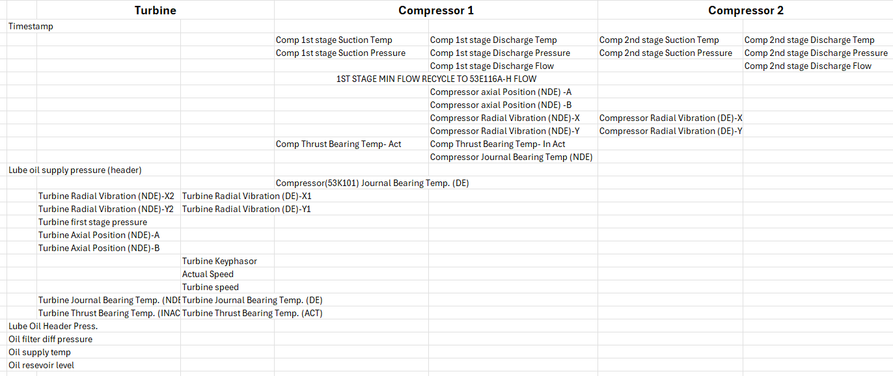
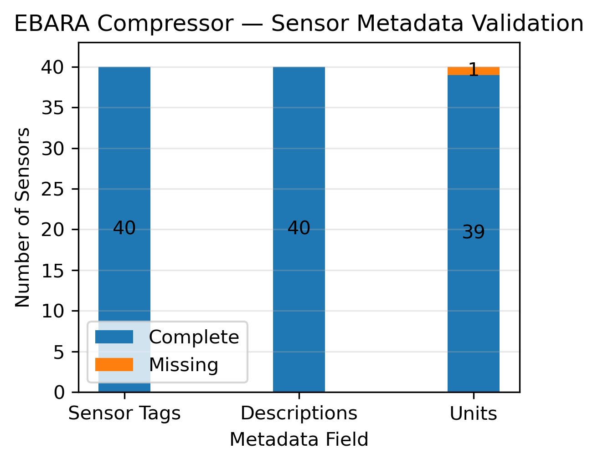
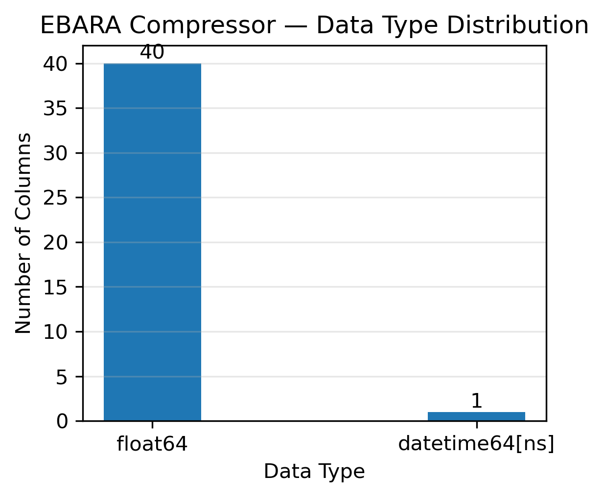
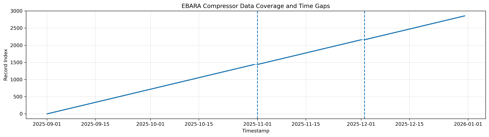
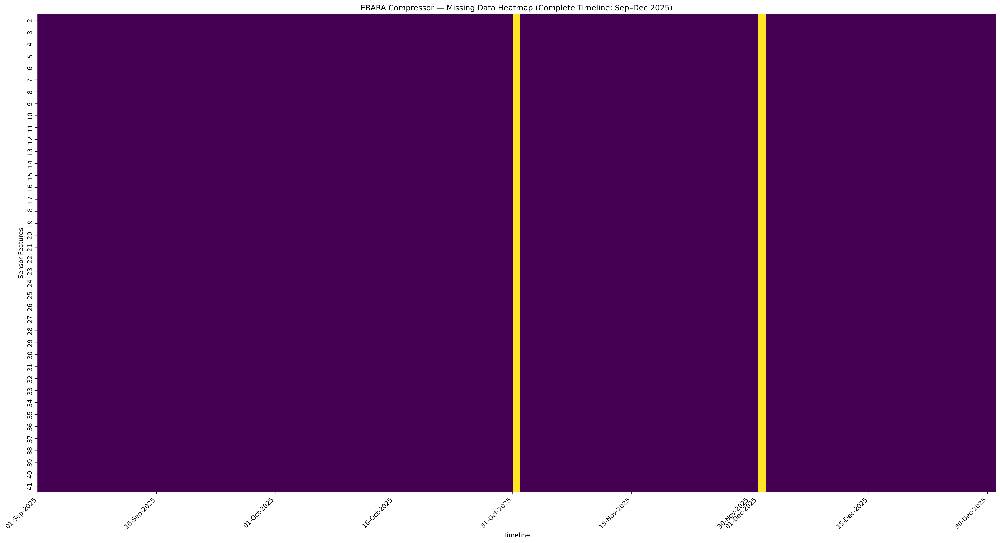
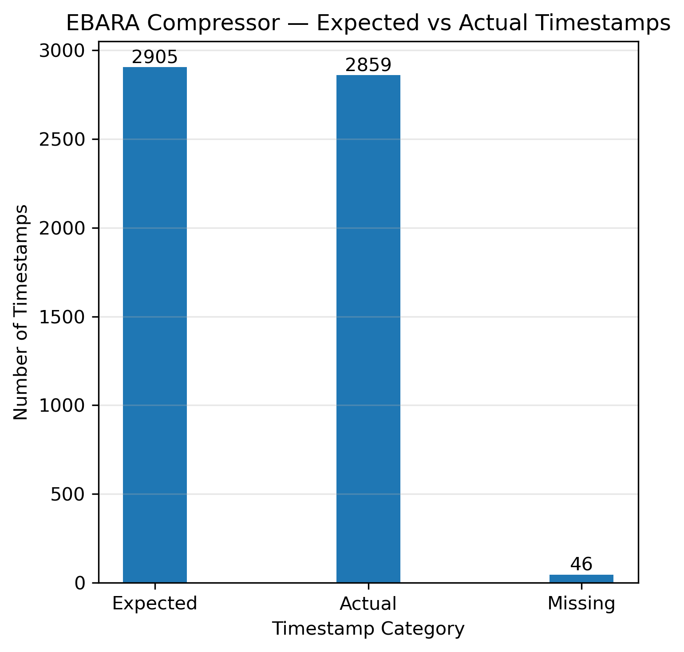
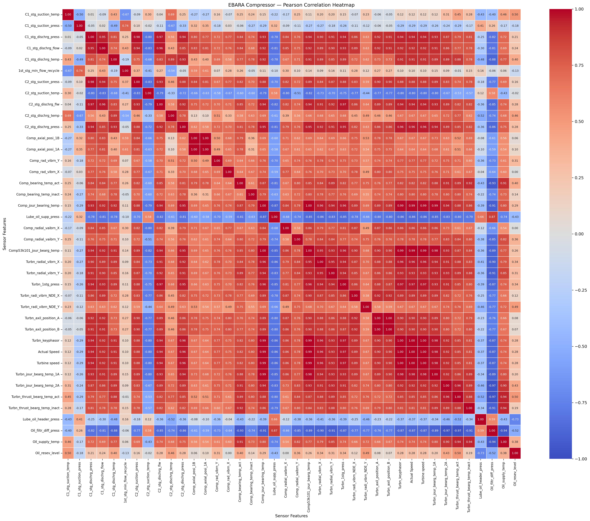
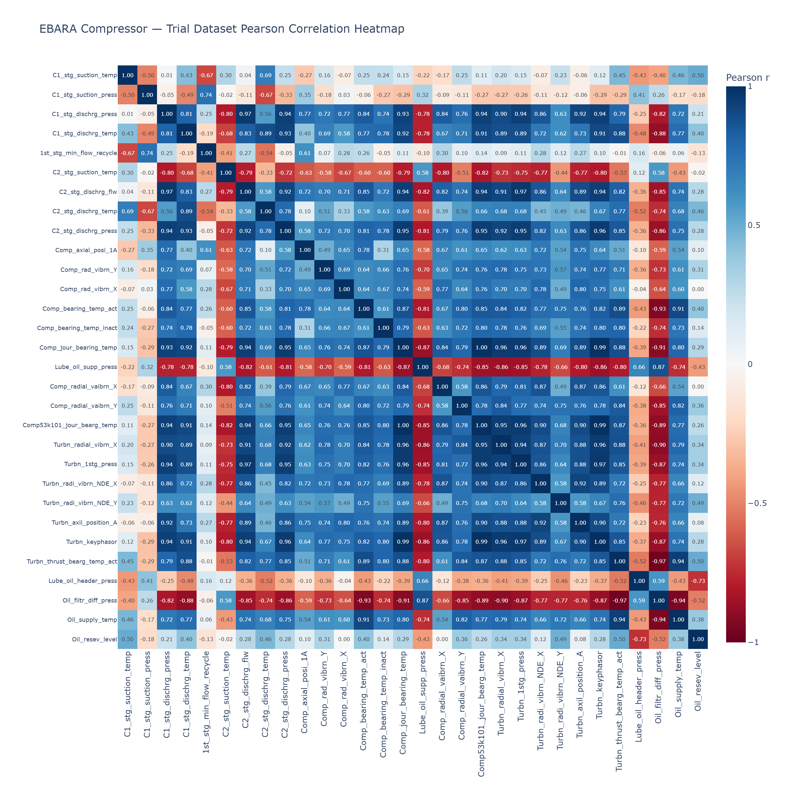

# Ebara_Compressor Failure_Prediction
---

  ## EBARA Compressor — Sensor Layout [ Turbine - Compressor1 - Compressor2 ]

----
----
## EBARA Compressor Analysis

Phase 1 — Input & File Validation
---
Input file: C:\Users\rakesh.r\Desktop\Project_Ebara_Compressor\Compressor-data.csv

* Input exists: True
* Is file: True

Dataset loaded successfully.
* Rows    : 2864 and Columns : 42
* Columns : 42

Dataset shape: (2864, 42), where

* Empty column indices:    [0]
* Empty row indices: [0, 1]

Total number of rows : 2862 and Columns : 41

##  Phase 2 : Inspect the metadata
* Finding for Feature's name and its units

    * Found that few features are same but not necessarily duplicate data.
        * Compressor axial Position (NDE) and 
Compressor axial Position (NDE)
        * Compressor Radial Vibration (NDE) and 
Compressor Radial Vibration (NDE)
    * Because there sensor data are different.

        * VZI5350901B.PV and VZI5350901A.PV
        * VYI5350901.PV and VXI5350901.PV
    * Found that the Tag SI5351103.PV — Turbine speed has no unit specified. need to verify next

    ----
## Phase 3 : Extract the actual 40-sensor metadata
* Keeping the feature 'Timestamp' apart || dtype is different 
* Metadata Validation overview
    

    * column_index : 33    
      Unit  : NaN    
      tag: SI5351103.PV    
      description : Turbine speed

----
## Phase 4 — Dataset Cleaning & Preparation.

* Found that
    * Timestamp column: 1 and  
Number of sensor columns: 40 

    * Converted Timestamp datatype: datetime64[ns] and other sensor data to float

    * Verifying the sensor columns with missing values and duplicate rows

    * Final EBARA Compressor — Data Type Distribution is
        

---
## Phase 5 : Checking consecutive time intervals & finding the missing
---
* Calculating data distributed wrt time differences found that
    * 0 days | 01:00:00  | : 2856
    * 1 days | 00:00:00  | :  2

* Compressor Data Coverage and Time Gaps
    

    * 1446	: 2025-10-31 | 1 days      
      2167	: 2025-12-01 | 1 days

    

* Duplicate timestamps || Now we are asking for does the same timestamp appear more than once    
    * Found that duplicate timestamps: 0

* Comparing Expected vs Actual timestamps
    * Expected hourly timestamps: 2905  
      Actual timestamps: 2859     
      Missing hourly timestamps: 46  || 24hrs X 2Days - 2
    
* Expected vs Actual Timestamps
    

---
### Phase 6 — Missing Value Analysis
---
* Overview of the data avilability    
    * Number of actual values per Feature is : 2859
      Total sensor values: 114360    
      Total missing sensor values: 0   
      Overall missing percentage: 0.0 %

    * Nub of readings per day : 24  
      Missing number of days : 2   
      Total missing values : 46

---
### Phase 7 — Verified for Data Type & Duplicate values.
---
* Timestamp datatype : datetime64[ns]
* Sensor data types : float64    40
* Name: count, dtype: int64
* Total duplicate rows: 0
* Total duplicate timestamps: 0

---
### Phase 8 — Statistical / Descriptive Analysis
---
* Execuiting the descriptive analysis, converted the feature's diff units into single standard unit for clear comparsion & visulization
* Total sensor values : 114360
* Rows with missing sensor values: 0
* Maximum missing sensors in any row: 0

### Phase 9 — Correlation Analysis
---
* Re-labeling the features temporarily.
* Calculating the Pearson correlation, (plotly supported)
  

* Level1: Features Engineering
   * Considering Model "Turbine-Compressor1-Compressor2" workflow

   * Dropped 9 Features, correlation>95% and maintaned similar relation with eachother
    
* Calculating the Pearson correlation, (plotly supported)
  

 
  
 
 
 
 
 
 